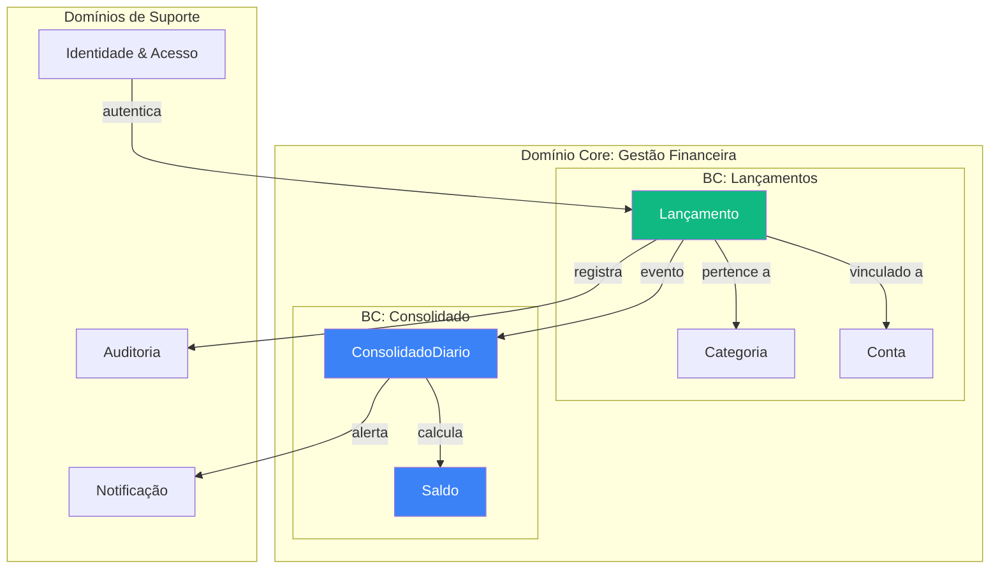
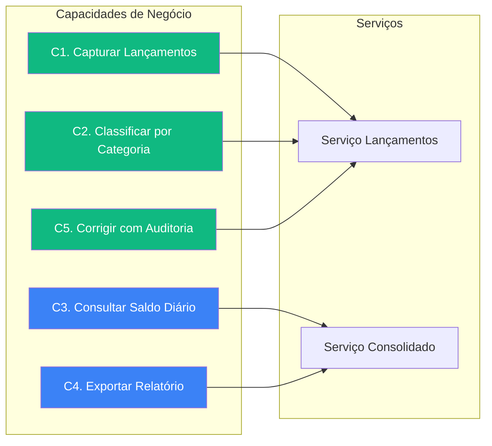
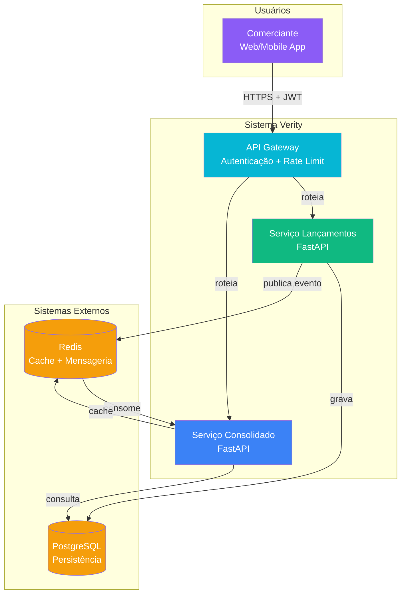
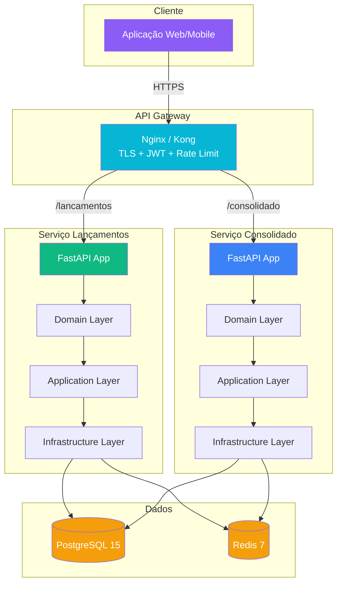
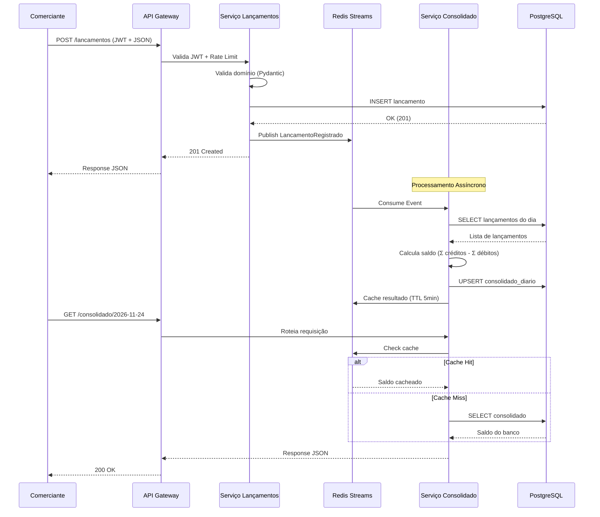
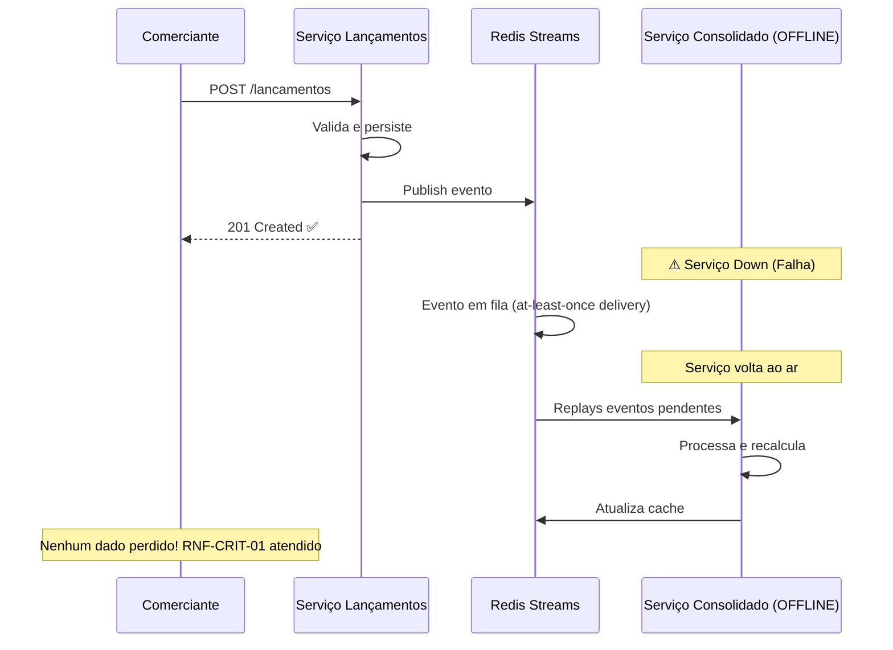
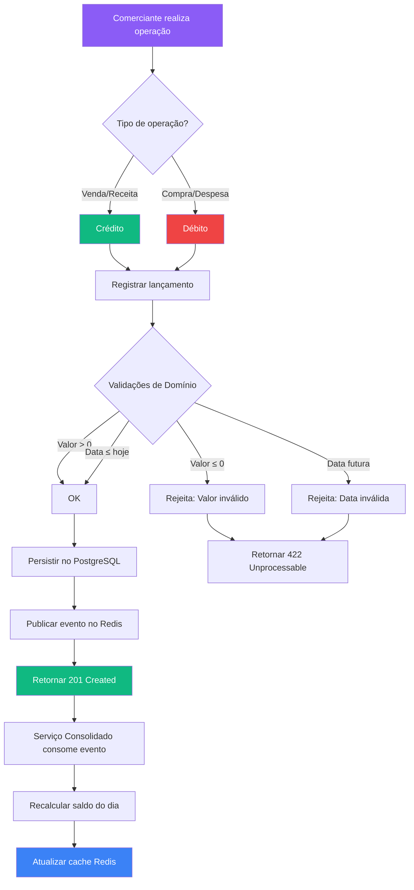
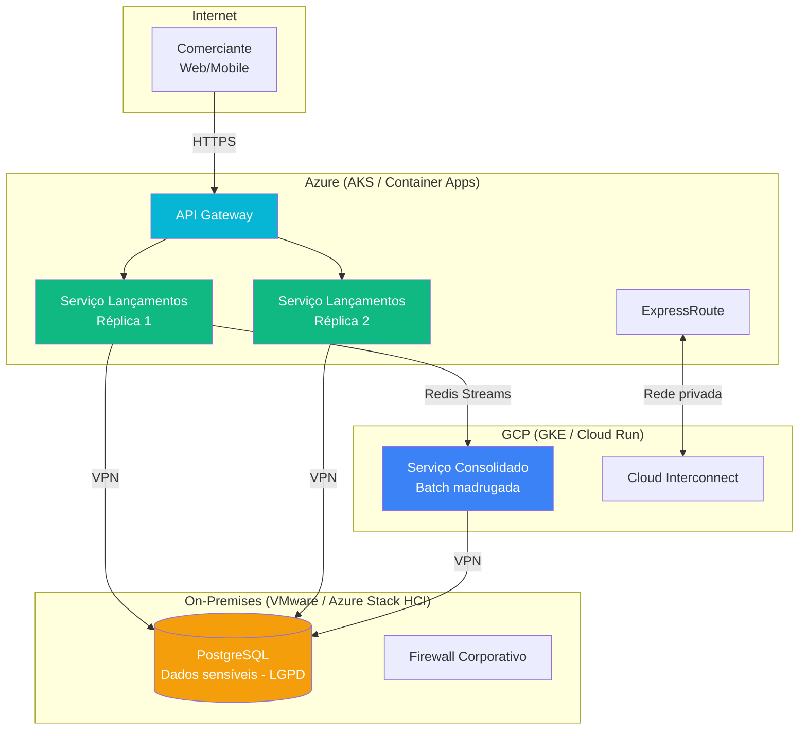
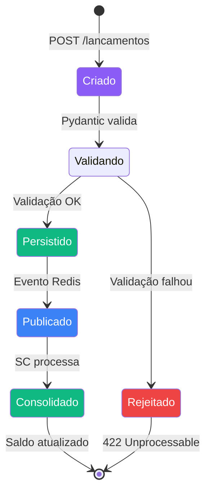
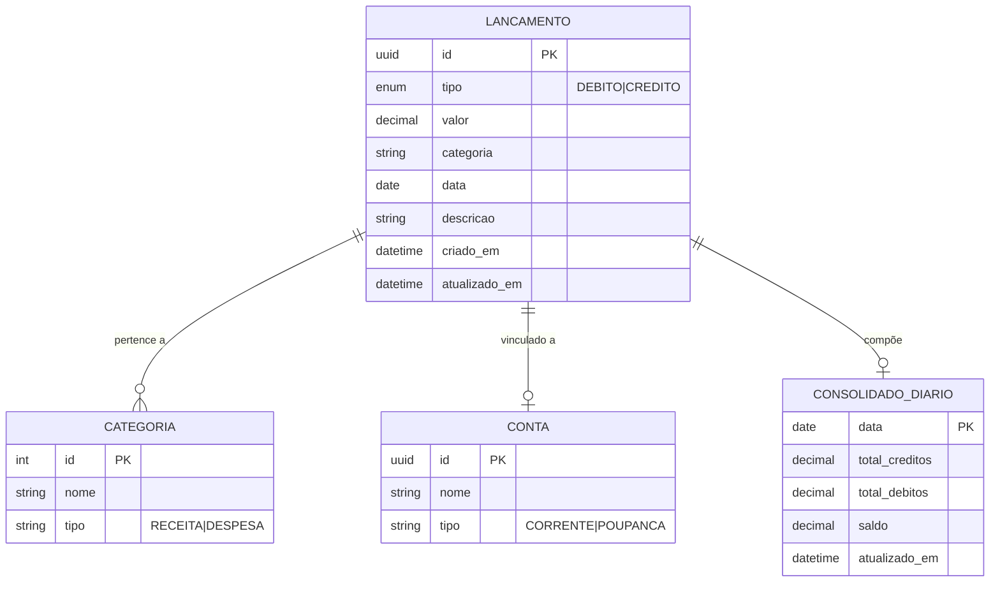

# 📊 Diagramas Gráficos — Desafio Verity

Este documento contém a representação visual completa da arquitetura, processos e dados do projeto.

> 💡 **Dica:** No GitHub, os diagramas Mermaid são renderizados automaticamente.

---

## 1. Domínio DDD (Bounded Contexts)

---

## 2. Mapa de Capacidades de Negócio

---

## 3. C4 — Nível de Contexto

---

## 4. C4 — Nível de Container

---

## 5. Sequência — Fluxo Principal (Happy Path)

---

## 6. Sequência — Cenário de Falha (Resiliência)

---

## 7. Fluxograma de Processo de Negócio

---

## 8. Diagrama de Implantação (Deploy Híbrido)

---

## 9. Diagrama de Estados — Ciclo de Vida do Lançamento

---

## 10. Diagrama ER (Entidade-Relacionamento)

---

## 📋 Resumo dos Diagramas

| # | Diagrama | Tipo | Descrição |
|---|----------|------|-----------|
| 1 | **Domínio DDD** | Graph | Bounded contexts e entidades do domínio |
| 2 | **Mapa de Capacidades** | Graph | Capacidades de negócio mapeadas para serviços |
| 3 | **C4 — Contexto** | Graph | Visão macro do sistema e atores externos |
| 4 | **C4 — Container** | Graph | Componentes internos e comunicação |
| 5 | **Sequência — Fluxo Principal** | Sequence | Happy path completo da requisição |
| 6 | **Sequência — Cenário de Falha** | Sequence | Resiliência quando consolidado está offline |
| 7 | **Fluxograma de Negócio** | Flowchart | Processo de registro e consolidação |
| 8 | **Implantação Híbrida** | Graph | Deploy em On-premises + Azure + GCP |
| 9 | **Estados do Lançamento** | State | Ciclo de vida completo da entidade |
| 10 | **Diagrama ER** | ER | Modelo de dados relacional |

---

*Documento elaborado por **Francisco Casarotto** — Arquiteto de Soluções*  
*Última atualização: Novembro/2026*
